This chapter lists every menu in Pencil2D's main window, in the order they appear, with every item,
its default keyboard shortcut and a one-line description. Follow the links to the chapter that
explains each feature in full. Use it when you know a command exists but not where it lives, or
when you want to know what an unfamiliar menu item does.

> **Note:** On macOS, press <kbd>Cmd</kbd> wherever this page says <kbd>Ctrl</kbd>, and
> <kbd>Option</kbd> wherever it says <kbd>Alt</kbd>. macOS also moves **Preferences**, **About**
> and **Exit** (shown as **Quit**) into the **Pencil2D** application menu.

<!-- VERIFY: About and Exit have no explicit menuRole in mainwindow2.ui; their move to the macOS application menu relies on Qt's default TextHeuristicRole. Preferences has an explicit PreferencesRole. -->

Shortcuts shown are the defaults; a dash (–) means none. You can change them in
[Preferences → Shortcuts](/doc/manual/shortcuts.html#customizing). Items that only make sense in
certain situations are greyed out otherwise; the descriptions say when.



## File {#file}

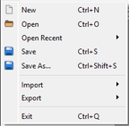

| Item | Shortcut | What it does |
|---|---|---|
| **New** | <kbd>Ctrl</kbd>+<kbd>N</kbd> | Starts a new project, from a preset if you have set one up. See [New projects](/doc/manual/projects.html#new-project). |
| **Open** | <kbd>Ctrl</kbd>+<kbd>O</kbd> | Opens a saved project (`.pclx` or `.pcl`). See [Projects and Files](/doc/manual/projects.html). |
| **Open Recent** ▸ | – | Lists up to 10 recently opened or saved projects. **Clear** empties the list; **Empty** is shown when there is nothing to list. |
| **Save** | <kbd>Ctrl</kbd>+<kbd>S</kbd> | Saves the project. The first time, asks for a file name. See [Saving](/doc/manual/projects.html#saving). |
| **Save As...** | <kbd>Ctrl</kbd>+<kbd>Shift</kbd>+<kbd>S</kbd> | Saves the project under a new name or in a new place. |
| **Import** ▸ | | Brings images, video, sound, palettes and layers into the project. See [Import](#import). |
| **Export** ▸ | | Saves the animation as images, a movie or a GIF, or saves the palette. See [Export](#export). |
| **Exit** | <kbd>Ctrl</kbd>+<kbd>Q</kbd> | Closes Pencil2D, asking first if there are unsaved changes. |

### Import {#import}

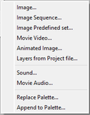

**File → Import**:

| Item | Shortcut | What it does |
|---|---|---|
| **Image...** | – | Imports one image into the current layer at the current frame. See [Importing an image](/doc/manual/import-export.html#import-image). |
| **Image Sequence...** | – | Imports several images, one after another, as keyframes. See [Importing an image sequence](/doc/manual/import-export.html#import-image-sequence). |
| **Image Predefined set...** | – | Imports a set of numbered images (like `Joe001.png`, `Joe002.png`) found from one file you pick. See [Importing and Exporting](/doc/manual/import-export.html). |
| **Movie Video...** | – | Imports the frames of a video file (needs FFmpeg). See [Importing a movie](/doc/manual/import-export.html#import-movie). |
| **Animated Image...** | – | Imports the frames of an animated GIF or other animated image. See [Importing an animated image](/doc/manual/import-export.html#import-gif). |
| **Layers from Project file...** | – | Copies layers from another Pencil2D project into this one. See [Importing and Exporting](/doc/manual/import-export.html). |
| **Sound...** | – | Imports a sound file into a sound layer, offering to create one if the current layer isn't a sound layer. See [Importing sound](/doc/manual/import-export.html#import-sound). |
| **Movie Audio...** | – | Imports the soundtrack of a video file into a sound layer. See [Importing sound](/doc/manual/import-export.html#import-sound). |
| **Replace Palette...** | – | Opens a palette file and replaces the current palette with it. See [Palette](/doc/manual/color.html#palette). |
| **Append to Palette...** | – | Adds the colors from a palette file to the current palette. See [Palette](/doc/manual/color.html#palette). |

### Export {#export}

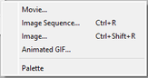

**File → Export**:

| Item | Shortcut | What it does |
|---|---|---|
| **Movie...** | – | Exports the animation as a video file. See [Exporting a movie](/doc/manual/import-export.html#export-movie). |
| **Image Sequence...** | <kbd>Ctrl</kbd>+<kbd>R</kbd> | Exports every frame as a numbered image file. See [Exporting an image sequence](/doc/manual/import-export.html#export-image-sequence). |
| **Image...** | <kbd>Ctrl</kbd>+<kbd>Shift</kbd>+<kbd>R</kbd> | Exports the current frame as one image. See [Exporting an image](/doc/manual/import-export.html#export-image). |
| **Animated GIF...** | – | Exports the animation as an animated GIF. See [Exporting a GIF](/doc/manual/import-export.html#export-gif). |
| **Palette** | – | Saves the current palette to a file. See [Palette](/doc/manual/color.html#palette). |

## Edit {#edit}

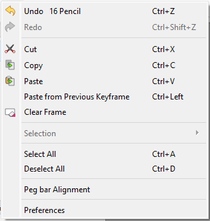

| Item | Shortcut | What it does |
|---|---|---|
| **Undo** | <kbd>Ctrl</kbd>+<kbd>Z</kbd> | Undoes the last change. The menu shows what will be undone. |
| **Redo** | <kbd>Ctrl</kbd>+<kbd>Shift</kbd>+<kbd>Z</kbd> | Redoes the last change you undid. |
| **Cut** | <kbd>Ctrl</kbd>+<kbd>X</kbd> | Copies the selection (or the selected frames) to the clipboard and removes it. See [Clipboard](/doc/manual/selection.html#clipboard). |
| **Copy** | <kbd>Ctrl</kbd>+<kbd>C</kbd> | Copies the selection or the selected frames to the clipboard; with nothing selected, copies the whole drawing. See [Copying frames](/doc/manual/timeline.html#copy-paste). |
| **Paste** | <kbd>Ctrl</kbd>+<kbd>V</kbd> | Pastes the clipboard's drawing or frames. Greyed out when there is nothing that fits the current layer. |
| **Paste from Previous Keyframe** | <kbd>Ctrl</kbd>+<kbd>←</kbd> | Pastes the drawing from the previous keyframe (only the selected area, on a bitmap layer with a selection) into the current keyframe. Needs a keyframe on the current frame. |
| **Clear Frame** | – | Erases the whole drawing on the current frame of the current bitmap or vector layer. |
| **Selection** ▸ **Flip X** | – | Flips the selection horizontally (mirror left to right). Only available while something is selected. See [Transforming](/doc/manual/selection.html#transforming). |
| **Selection** ▸ **Flip Y** | – | Flips the selection vertically (upside down). Only available while something is selected. |
| **Select All** | <kbd>Ctrl</kbd>+<kbd>A</kbd> | Selects everything on the current frame of the current layer. See [Making a selection](/doc/manual/selection.html#making-a-selection). |
| **Deselect All** | <kbd>Ctrl</kbd>+<kbd>D</kbd> | Removes the selection. |
| **Peg bar Alignment** | – | Opens the peg bar alignment dialog for lining up drawings using registration marks. See [Peg bar alignment](/doc/manual/selection.html#peg-bar-alignment). |
| **Preferences** | – | Opens the Preferences dialog (in the **Pencil2D** menu on macOS). See [Preferences](/doc/manual/preferences.html). |

## View {#view}

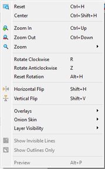

| Item | Shortcut | What it does |
|---|---|---|
| **Reset** | <kbd>Ctrl</kbd>+<kbd>H</kbd> | Resets pan, zoom (to 100%) and rotation of the canvas view. |
| **Center** | <kbd>Ctrl</kbd>+<kbd>Shift</kbd>+<kbd>H</kbd> | Moves the view back to the center of the canvas, keeping the zoom and rotation. See [Panning](/doc/manual/canvas.html#pan). |
| **Zoom In** | <kbd>Ctrl</kbd>+<kbd>↑</kbd> | Zooms in one step. See [Zoom](/doc/manual/canvas.html#zoom). |
| **Zoom Out** | <kbd>Ctrl</kbd>+<kbd>↓</kbd> | Zooms out one step. |
| **Zoom** ▸ | | Jumps to a set zoom level. See [Zoom](#zoom). |
| **Rotate Clockwise** | <kbd>R</kbd> | Rotates the view 15° clockwise. See [Rotating the view](/doc/manual/canvas.html#rotate). |
| **Rotate Anticlockwise** | <kbd>Z</kbd> | Rotates the view 15° anticlockwise. |
| **Reset Rotation** | <kbd>Alt</kbd>+<kbd>H</kbd> | Sets the view rotation back to 0°. |
| **Horizontal Flip** | <kbd>Shift</kbd>+<kbd>H</kbd> | Mirrors the view left to right (a check mark shows when on). Your drawing is not changed. See [Flipping the view](/doc/manual/canvas.html#flip). |
| **Vertical Flip** | <kbd>Shift</kbd>+<kbd>V</kbd> | Turns the view upside down (a check mark shows when on). Your drawing is not changed. |
| **Overlays** ▸ | | Guides drawn over the canvas. See [Overlays](#overlays). |
| **Onion Skin** ▸ | | Turns onion skinning on and off. See [Onion Skin](#onion-skin-menu). |
| **Layer Visibility** ▸ | | Chooses how layers other than the current one are shown. See [Layer Visibility](#layer-visibility-menu). |
| **Show Invisible Lines** | – | Shows vector strokes that are set to be invisible. Vector layers only. See [Canvas and View](/doc/manual/canvas.html). |
| **Show Outlines Only** | – | Shows vector artwork as thin outlines without fills or stroke width. Vector layers only. |
| **Preview** | <kbd>Alt</kbd>+<kbd>P</kbd> | Always greyed out in 0.7.2. |

### Zoom {#zoom}

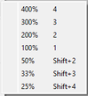

**View → Zoom**:

| Item | Shortcut | What it does |
|---|---|---|
| **400%** | <kbd>4</kbd> | Sets the zoom to 400%. |
| **300%** | <kbd>3</kbd> | Sets the zoom to 300%. |
| **200%** | <kbd>2</kbd> | Sets the zoom to 200%. |
| **100%** | <kbd>1</kbd> | Sets the zoom to 100% (actual size). |
| **50%** | <kbd>Shift</kbd>+<kbd>2</kbd> | Sets the zoom to 50%. |
| **33%** | <kbd>Shift</kbd>+<kbd>3</kbd> | Sets the zoom to 33%. |
| **25%** | <kbd>Shift</kbd>+<kbd>4</kbd> | Sets the zoom to 25%. |

### Overlays {#overlays}

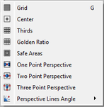

**View → Overlays**. Each item is a check box that shows or hides a guide; none of them appear in
exports. See [Overlays](/doc/manual/canvas.html#overlays).

| Item | Shortcut | What it does |
|---|---|---|
| **Grid** | <kbd>G</kbd> | Shows a grid; set its spacing in [Preferences → General](/doc/manual/preferences.html#grid). |
| **Center** | – | Marks the center of the camera view. |
| **Thirds** | – | Divides the camera view into thirds (rule of thirds). |
| **Golden Ratio** | – | Divides the camera view by the golden ratio. |
| **Safe Areas** | – | Shows the action-safe and title-safe frames set in [Preferences → General](/doc/manual/preferences.html#overlays). Greyed out if both are turned off there. |
| **One Point Perspective** | – | Shows perspective lines to one vanishing point. See [Perspective](/doc/manual/canvas.html#perspective). |
| **Two Point Perspective** | – | Shows perspective lines to two vanishing points. |
| **Three Point Perspective** | – | Shows perspective lines to three vanishing points. |
| **Perspective Lines Angle** ▸ | – | Sets the angle between perspective lines: **2°**, **3°**, **5°**, **7.5°**, **10°**, **15°** (default), **20°** or **30°**. |

### Onion Skin {#onion-skin-menu}

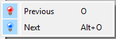

**View → Onion Skin**. See [Onion Skin](/doc/manual/onion-skin.html).

| Item | Shortcut | What it does |
|---|---|---|
| **Previous** | <kbd>O</kbd> | Shows or hides onion skins of previous frames. |
| **Next** | <kbd>Alt</kbd>+<kbd>O</kbd> | Shows or hides onion skins of following frames. |

### Layer Visibility {#layer-visibility-menu}

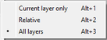

**View → Layer Visibility**. Only one can be chosen at a time. See
[Layer visibility](/doc/manual/canvas.html#layer-visibility).

| Item | Shortcut | What it does |
|---|---|---|
| **Current layer only** | <kbd>Alt</kbd>+<kbd>1</kbd> | Shows only the current layer. |
| **Relative** | <kbd>Alt</kbd>+<kbd>2</kbd> | Fades layers more the further they are from the current layer. |
| **All layers** | <kbd>Alt</kbd>+<kbd>3</kbd> | Shows all layers normally (the default). |

## Animation {#animation}

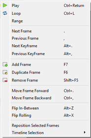

| Item | Shortcut | What it does |
|---|---|---|
| **Play** | <kbd>Ctrl</kbd>+<kbd>Enter</kbd> | Plays the animation; while playing, the item reads **Stop**. See [Playback](/doc/manual/timeline.html#playback). |
| **Loop** | <kbd>Ctrl</kbd>+<kbd>L</kbd> | When checked, playback starts over at the end instead of stopping. |
| **Range** | – | When checked, playback uses only the frame range set on the timeline. |
| **Next Frame** | <kbd>.</kbd> | Goes to the next frame. |
| **Previous Frame** | <kbd>,</kbd> | Goes to the previous frame. |
| **Next Keyframe** | <kbd>Alt</kbd>+<kbd>.</kbd> | Goes to the next keyframe on the current layer. |
| **Previous KeyFrame** | <kbd>Alt</kbd>+<kbd>,</kbd> | Goes to the previous keyframe on the current layer. |
| **Add Frame** | <kbd>F7</kbd> | Adds a new blank keyframe at the current frame, or just after it if the current frame is already a keyframe (later keyframes move along). On a sound layer, asks for a sound file to import instead. See [Keyframes](/doc/manual/timeline.html#keyframes). |
| **Duplicate Frame** | <kbd>F6</kbd> | Copies the keyframe at the current frame to the next empty frame. |
| **Remove Frame** | <kbd>Shift</kbd>+<kbd>F5</kbd> | Deletes the keyframe at the current frame. Every layer except a sound layer keeps at least one keyframe. |
| **Move Frame Forward** | <kbd>Ctrl</kbd>+<kbd>.</kbd> | Moves the keyframe at the current frame one frame later. |
| **Move Frame Backward** | <kbd>Ctrl</kbd>+<kbd>,</kbd> | Moves the keyframe at the current frame one frame earlier. |
| **Flip In-Between** | <kbd>Alt</kbd>+<kbd>Z</kbd> | On a frame between two keyframes, flashes the keyframe before, the current frame and the keyframe after, to check an in-between drawing. Timing is set in [Preferences → Timeline](/doc/manual/preferences.html#flip-and-roll). |
| **Flip Rolling** | <kbd>Alt</kbd>+<kbd>X</kbd> | Flashes through the previous few keyframes (5 by default) up to the current frame. |
| **Reposition Selected Frames** | – | Opens a dialog for moving the drawings on several selected frames at once; select at least 2 frames first. Switches to the Move tool. See [Timeline and Animation](/doc/manual/timeline.html). |
| **Timeline Selection** ▸ | | Commands for the frames selected on the timeline. See [Timeline Selection](#timeline-selection). |

### Timeline Selection {#timeline-selection}

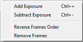

**Animation → Timeline Selection**. See [Selecting frames](/doc/manual/timeline.html#selecting-frames).

| Item | Shortcut | What it does |
|---|---|---|
| **Add Exposure** | <kbd>Ctrl</kbd>+<kbd>+</kbd> | Holds each selected keyframe one frame longer, moving later keyframes along. With nothing selected, works on the current keyframe. See [Exposure](/doc/manual/timeline.html#exposure). |
| **Subtract Exposure** | <kbd>Ctrl</kbd>+<kbd>-</kbd> | Holds each selected keyframe one frame shorter. With nothing selected, works on the current keyframe. |
| **Reverse Frames Order** | – | Reverses the order of the selected keyframes. |
| **Remove Frames** | – | Deletes the selected keyframes, after asking. This can't be undone. |

## Tools {#tools}

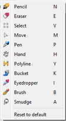

Each item selects a tool. See [Tools](/doc/manual/tools.html).

| Item | Shortcut | What it does |
|---|---|---|
| **Pencil** | <kbd>N</kbd> | Selects the [Pencil](/doc/manual/tools.html#pencil) tool. |
| **Eraser** | <kbd>E</kbd> | Selects the [Eraser](/doc/manual/tools.html#eraser) tool. |
| **Select** | <kbd>V</kbd> | Selects the [Select](/doc/manual/tools.html#select) tool. |
| **Move** | <kbd>M</kbd> | Selects the [Move](/doc/manual/tools.html#move) tool. |
| **Pen** | <kbd>P</kbd> | Selects the [Pen](/doc/manual/tools.html#pen) tool. |
| **Hand** | <kbd>H</kbd> | Selects the [Hand](/doc/manual/tools.html#hand) tool. |
| **Polyline** | <kbd>Y</kbd> | Selects the [Polyline](/doc/manual/tools.html#polyline) tool. |
| **Bucket** | <kbd>K</kbd> | Selects the [Bucket](/doc/manual/tools.html#bucket) tool. |
| **Eyedropper** | <kbd>I</kbd> | Selects the [Eyedropper](/doc/manual/tools.html#eyedropper) tool. |
| **Brush** | <kbd>B</kbd> | Selects the [Brush](/doc/manual/tools.html#brush) tool. |
| **Smudge** | <kbd>A</kbd> | Selects the [Smudge](/doc/manual/tools.html#smudge) tool. |
| **Reset to default** | – | Resets the options of every tool (size, feather and so on) to Pencil2D's built-in values, which differ from a new installation's starting sizes. See [Tools](/doc/manual/tools.html). |

## Layer {#layer}

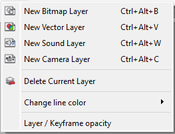

| Item | Shortcut | What it does |
|---|---|---|
| **New Bitmap Layer** | <kbd>Ctrl</kbd>+<kbd>Alt</kbd>+<kbd>B</kbd> | Asks for a name and adds a bitmap (pixel) layer. See [Layer types](/doc/manual/layers.html#layer-types). |
| **New Vector Layer** | <kbd>Ctrl</kbd>+<kbd>Alt</kbd>+<kbd>V</kbd> | Asks for a name and adds a vector layer. |
| **New Sound Layer** | <kbd>Ctrl</kbd>+<kbd>Alt</kbd>+<kbd>W</kbd> | Asks for a name and adds a sound layer. See [Sound](/doc/manual/sound.html#adding-sound). |
| **New Camera Layer** | <kbd>Ctrl</kbd>+<kbd>Alt</kbd>+<kbd>C</kbd> | Asks for a name and adds a camera layer. See [Camera layer](/doc/manual/camera.html#camera-layer). |
| **Delete Current Layer** | – | Deletes the current layer after asking; this can't be undone. A project must keep at least one camera layer. See [Managing layers](/doc/manual/layers.html#managing-layers). |
| **Change line color** ▸ | | Recolors bitmap drawings. Bitmap layers only. See [Change line color](#change-line-color). |
| **Layer / Keyframe opacity** | – | Opens a dialog for changing the opacity of the layer or of its keyframes. See [Opacity](/doc/manual/layers.html#opacity). |

### Change Line Color {#change-line-color}

**Layer → Change line color**. Both items paint every non-transparent pixel of a bitmap drawing
with the current color, for example to turn a rough sketch into light blue guide lines.

| Item | Shortcut | What it does |
|---|---|---|
| **Current keyframe** | – | Recolors the drawing on the current frame, which must be a keyframe. |
| **All keyframes on layer** | – | Recolors every keyframe on the current layer. |

## Windows {#windows}

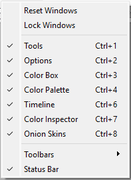

| Item | Shortcut | What it does |
|---|---|---|
| **Reset Windows** | – | Puts all panels back in their original places and shows any you had closed. See [Arranging windows](/doc/manual/interface.html#arranging-windows). |
| **Lock Windows** | – | When checked, panels can't be moved, floated or closed, and their title bars are hidden. |
| **Tools** | <kbd>Ctrl</kbd>+<kbd>1</kbd> | Shows or hides the [Tools](/doc/manual/interface.html#toolbox) panel. |
| **Options** | <kbd>Ctrl</kbd>+<kbd>2</kbd> | Shows or hides the tool [Options](/doc/manual/interface.html#tool-options) panel. |
| **Color Box** | <kbd>Ctrl</kbd>+<kbd>3</kbd> | Shows or hides the color wheel panel. See [Color wheel](/doc/manual/color.html#color-wheel). |
| **Color Palette** | <kbd>Ctrl</kbd>+<kbd>4</kbd> | Shows or hides the palette panel. See [Palette](/doc/manual/color.html#palette). |
| **Timeline** | <kbd>Ctrl</kbd>+<kbd>6</kbd> | Shows or hides the [Timeline](/doc/manual/interface.html#timeline-panel) panel. |
| **Color Inspector** | <kbd>Ctrl</kbd>+<kbd>7</kbd> | Shows or hides the [Color Inspector](/doc/manual/color.html#color-inspector) panel. |
| **Onion Skins** | <kbd>Ctrl</kbd>+<kbd>8</kbd> | Shows or hides the [Onion Skins](/doc/manual/onion-skin.html#onion-skin-panel) panel. |
| **Toolbars** ▸ | | Shows or hides each toolbar. See [Toolbars](#toolbars-menu). |
| **Status Bar** | – | Shows or hides the [status bar](/doc/manual/interface.html#status-bar) at the bottom of the window (on by default). |

### Toolbars {#toolbars-menu}

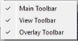

**Windows → Toolbars**. See [Toolbars](/doc/manual/interface.html#toolbars).

| Item | Shortcut | What it does |
|---|---|---|
| **Main Toolbar** | – | Shows or hides the toolbar with New, Open, Save, Undo, Redo, Cut, Copy, Paste and Clear Frame. |
| **View Toolbar** | – | Shows or hides the toolbar with Zoom In, Zoom Out, Reset, the two view flips, Show Invisible Lines and Show Outlines Only. |
| **Overlay Toolbar** | – | Shows or hides the toolbar with the overlay switches and the perspective lines angle. |

## Help {#help}

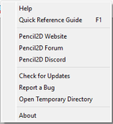

| Item | Shortcut | What it does |
|---|---|---|
| **Help** | – | Opens the Pencil2D documentation on the website in your web browser. |
| **Quick Reference Guide** | <kbd>F1</kbd> | Saves the Quick Reference Guide PDF to your Documents folder and opens it. |
| **Pencil2D Website** | – | Opens [pencil2d.org](https://www.pencil2d.org/) in your web browser. |
| **Pencil2D Forum** | – | Opens the [community forum](https://discuss.pencil2d.org/) in your web browser. |
| **Pencil2D Discord** | – | Opens an invitation to the [Pencil2D Discord server](https://discord.gg/8FxdV2g). |
| **Check for Updates** | – | Checks online whether a newer version of Pencil2D is available. |
| **Report a Bug** | – | Opens the [bug tracker](https://github.com/pencil2d/pencil/issues) in your web browser. |
| **Open Temporary Directory** | – | After a warning, opens the folder where Pencil2D keeps working copies of open projects. Only needed to rescue work by hand; see the [project file recovery guide](/doc/project-file-recovery-guide.html). |
| **About** | – | Shows the Pencil2D version and credits (in the **Pencil2D** menu on macOS). |


